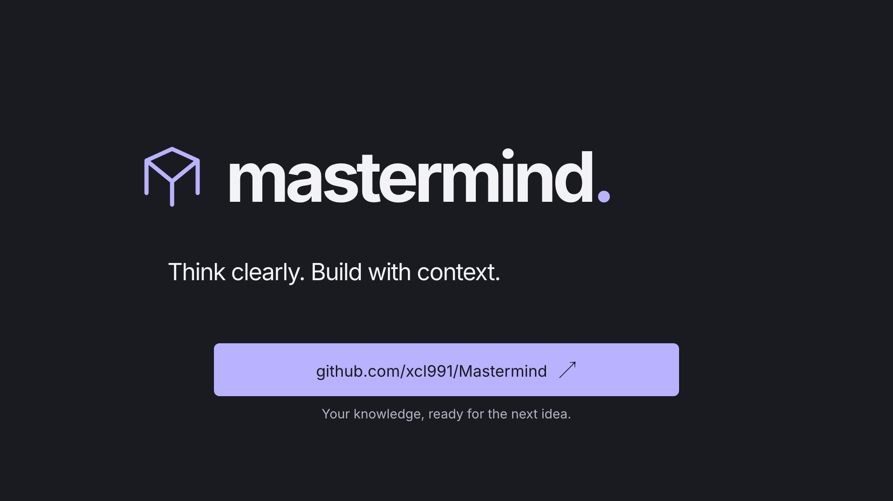

# Mastermind

A local workspace for Markdown notes, knowledge graphs, and AI agents. Keep your files on your own machine and give agents focused, cited evidence through MCP.

Mastermind indexes and retrieves locally. It requires no model API key, embedding service, or separate database.

## Meet Mastermind

[](https://github.com/xcl991/Mastermind/blob/main/docs/media/mastermind-film-1080p.mp4)

**[Watch the 48-second film](https://github.com/xcl991/Mastermind/blob/main/docs/media/mastermind-film-1080p.mp4)** · [Download MP4](https://raw.githubusercontent.com/xcl991/Mastermind/main/docs/media/mastermind-film-1080p.mp4) · Full English · 1080p

From connected notes and knowledge graphs to focused evidence for compatible AI agents, see how Mastermind turns local knowledge into useful context.

Music: “Cipher” by Kevin MacLeod (incompetech.com), [CC BY 4.0](https://creativecommons.org/licenses/by/4.0/). Edited for this film. [Full media credits](docs/media/CREDITS.md).

## Quick start

Install Node.js 22 or newer, then:

```sh
git clone https://github.com/xcl991/Mastermind.git
cd Mastermind
npm ci --omit=dev --ignore-scripts
npm start
```

Open **http://127.0.0.1:6969**. The editor is already bundled. The default workspace is `vault/`; a new default workspace receives example notes.

To keep the server running in the background:

```sh
npm run infra:init
npm run infra:start
npm run infra:health
```

Use `infra:stop`, `infra:restart`, `infra:status`, and `infra:logs` to manage it. Background mode does not install an OS startup service. [Infrastructure guide](docs/INFRASTRUCTURE.md).

## What you can do

- Write Markdown with autosave, revision checks, local history, draft recovery, and backlinks.
- Use properties, templates, tasks, callouts, embeds, local media, and mathematical notation.
- Query note metadata with TABLE, LIST, and TASK views.
- Explore knowledge and source-code graphs; import graph JSON and edit Canvas documents.
- Retrieve focused source excerpts with file, line, and revision citations.
- Connect agents through MCP stdio or local Streamable HTTP, with tools, resources, and prompts.
- Add declarative query, template, and theme extensions.
- Preview renames and backlink updates, recover interrupted workflows, and back up the complete workspace.

## Give agents less, better context

A vault does not reduce tokens by itself. Mastermind searches locally and returns relevant excerpts instead of routinely sending whole files or an entire project.

Start with `get_context` and a budget of about 1,000 estimated tokens. Use `get_section` when you already know the file and heading. Use `project_map` for orientation. The default `minimal` profile offers these three tools; `research` adds navigation and queries, and `full` enables revision-checked edits.

```sh
node src/cli.mjs mcp-config --vault "/path/to/vault"
node src/cli.mjs context --vault "/path/to/vault" --query "your question" --budget 1000 --text
```

The token estimate is UTF-8 bytes divided by three, not a provider tokenizer or billing measurement. Tool definitions, conversation history, output, retries, and provider caching also affect cost. Small known files may be cheaper to read directly. [Agent setup](docs/CLIENTS.md) · [Protocol contract](docs/AGENT-PROTOCOL.md).

The optional [Mastermind skill](skills/mastermind/SKILL.md) guides bounded retrieval, citations, and revision-safe edits. Place it in your agent client's supported skill directory if desired; it does not install itself.

## Bring your own files

```sh
node src/cli.mjs serve --vault "/path/to/vault"
node src/cli.mjs serve --vault "/path/to/project" --read-only --state-dir "/path/to/separate-state"
```

Markdown remains the source of truth. State normally lives in `vault/.mastermind`. Read-only projects require a separate state directory for caches. Indexing honors ignore files and configurable exclusions; it does not execute project code. JavaScript/TypeScript parsing is local; Python 3 is optional for Python AST indexing.

External disks need filesystem support for hard links and atomic rename. Stop all workspace writers before disconnecting storage. Backups should also exist on a different device.

## Documentation

- [Queries and metadata](docs/QUERY.md)
- [Extensions and document formats](docs/EXTENSIONS.md)
- [Editing workflows and recovery](docs/RECOVERY.md)
- [Local infrastructure and VPS preparation](docs/INFRASTRUCTURE.md)
- [Agent configuration](docs/CLIENTS.md)
- [Validation and operating boundaries](docs/VALIDATION.md)

The server is loopback-only. Remote public hosting, multiuser authorization, cloud synchronization, and native mobile apps are not included. Supported query and document formats are documented subsets. No claim of universal agent compatibility or zero defects is made.

## Development

```sh
npm ci --ignore-scripts
npm run check
npm test
npm run check:browser
npm run check:features
npm run check:security
```

Browser checks use an installed Chrome executable or `BROWSER_PATH`. Rebuild the bundled editor with `npm run build:editor` after changing its source. `npm run benchmark` uses synthetic fixtures and does not call a model API.

Create a source archive with `npm run package`. Packaging uses an explicit public-file allowlist and excludes user vaults, local configuration, state, logs, backups, and generated test results.

Third-party components retain their own licenses. See [dependency notices](THIRD_PARTY_NOTICES.md).
